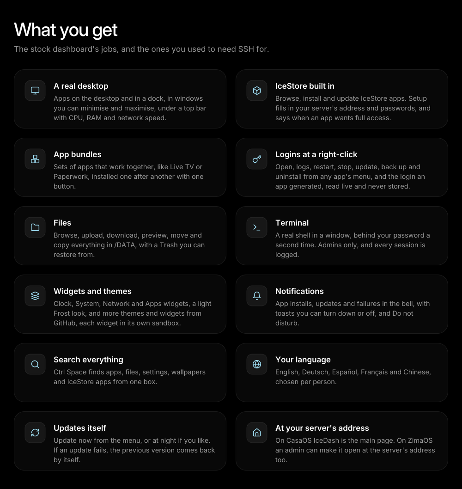
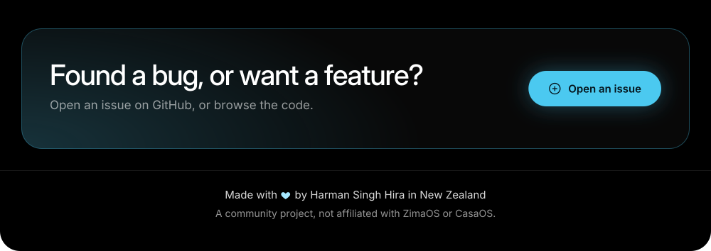

# IceDash

A desktop-style dashboard for [ZimaOS](https://www.zimaspace.com/ZimaOS) and [CasaOS](https://casaos.io/), with [IceStore](https://icestore.hsinghhira.me/) built in. You get your apps on a desktop and in a dock, widgets, notifications, Files, a Terminal and IceStore. On ZimaOS it sits beside the stock dashboard. On CasaOS it becomes the main page, with the stock CasaOS UI one click away.

<!-- README-SVGS:START -->
<p align="center"><a href="https://icedash.hsinghhira.me/#tour"></a
><a href="https://icedash.hsinghhira.me/#features"></a
><a href="https://icedash.hsinghhira.me/#install"></a
><a href="https://github.com/HSinghHira/IceDash/issues/new"></a
></p>
<!-- README-SVGS:END -->

## What it does

- **A real desktop:** apps on the desktop and in a dock, in windows you can minimise and maximise, under a top bar with CPU, RAM and network speed.
- **IceStore built in:** browse, install and update IceStore apps. The setup fills in your server's address and passwords, checks that ports are free, and warns you when an app wants full access to the server. **App bundles** install a set of apps that work together, one after another.
- **Right-click any app** to open, see its logs, restart, stop, update, back up or uninstall it, or to see the login it generated. That login is read live from the app and never stored.
- **Files** for everything in `/DATA` (upload, download, preview, move, copy, Trash) and a **Terminal** behind your password. Both are for admins only.
- **Widgets and themes:** Clock, System, Network and Apps widgets, a light look called Frost, and more themes and widgets from GitHub. Each widget runs in its own sandbox and asks for its permissions before you turn it on.
- **Notifications, search and languages:** app events in the bell, with Do not disturb. Ctrl Space searches apps, files and settings. IceDash comes in English, Deutsch, Español, Français and 中文.
- **Updates itself:** **Update now** from the menu, or install updates at night if you like. If an update fails, the previous version comes back by itself.
- **Members** get their own look, dock and notifications. Admins get everything else.

## Requirements

- **ZimaOS 1.8.0 or newer** (amd64)
- **CasaOS 0.4.15 or newer** (amd64 and arm64)

## Install on ZimaOS

Over SSH on your ZimaOS box:

```sh
cd /tmp
curl -fsSLO https://github.com/HSinghHira/IceDash/releases/latest/download/icedash-amd64.raw
curl -fsSLO https://github.com/HSinghHira/IceDash/releases/latest/download/icedash-amd64.raw.sha256
sha256sum -c icedash-amd64.raw.sha256
mv icedash-amd64.raw icedash.raw   # zpkg takes the module name from the file name
sudo zpkg install /tmp/icedash.raw
```

Then open the **IceDash** tile on the ZimaOS dashboard, or go to `http://<your-server>/modules/icedash/`. Sign in with your ZimaOS account. There's nothing else to set up.

To have IceDash open at `http://<your-server>/` itself, an admin turns on **Settings → General → Open IceDash at this server's address**. The ZimaOS dashboard then stays at `http://<your-server>/index.html`. Turning the setting off gives ZimaOS its address back within a few seconds.

To remove IceDash:

```sh
sudo icedash --uninstall     # removes IceDash's boot units and gives "/" back to ZimaOS
sudo zpkg remove icedash
```

IceDash keeps its notifications and settings in `/DATA/.icedash`. Delete that folder yourself if you don't want them any more.

## Install on CasaOS

Over SSH on your CasaOS box:

```sh
wget -qO- https://github.com/HSinghHira/IceDash/releases/latest/download/install-casaos.sh | sudo sh
```

Then open `http://<your-server>/`. IceDash is now the main page, and you sign in with your CasaOS account. The stock CasaOS UI is at `http://<your-server>/casaos/`, and IceDash links to it from its menu. Running the command again repairs or reinstalls IceDash.

To remove IceDash and put the stock CasaOS UI back at the main address:

```sh
sudo /opt/icedash/current/uninstall.sh            # keeps IceDash's settings in /DATA/.icedash
sudo /opt/icedash/current/uninstall.sh --purge    # removes those too
```

Apps you installed from IceDash stay in CasaOS either way.

## Updates

IceDash checks for new versions and shows **Update now** in its menu. If the new version doesn't start, the updater puts the previous one back. An admin can also turn on **Install updates at night** (02:00 to 05:00 in the time zone saved with the setting).

## Build

You need Go (the version in `go.mod`), Node.js 24, git and make. The image step needs Linux with `squashfs-tools`.

```sh
make check                     # vet and all tests (works on Windows and macOS too)
make build VERSION=v1.0.0      # the ZimaOS image, the CasaOS packages and their .sha256 in dist/
make casaos ARCH=arm64         # one CasaOS package
make preview                   # the desktop with sample data, on your PC
make site                      # the website, at http://localhost:8000
```

`make modkit` checks out [lintux-modkit](https://github.com/chicohaager/lintux-modkit) (MIT) into `.modkit` at the commit pinned in `lintux-modkit.ref`. Releases are made by CI from version tags (`vX.Y.Z`) only.

The pictures at the top of this README are drawn by `python scripts/readme_svgs.py` (needs `pillow` and `fonttools`) from the same content as the website in `site/`.

## Contributing

Bug reports, ideas and pull requests are welcome. See [CONTRIBUTING.md](CONTRIBUTING.md).

## License

[MIT](LICENSE) © Harman Singh Hira

## Thanks

IceDash's module packaging, gateway route, sign-in check and self-update follow [Module Manager](https://github.com/chicohaager/modmanager) and use [lintux-modkit](https://github.com/chicohaager/lintux-modkit), both by Holger Kuehn (MIT).

IceDash is a community project, not affiliated with ZimaOS (IceWhale) or CasaOS.
